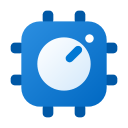
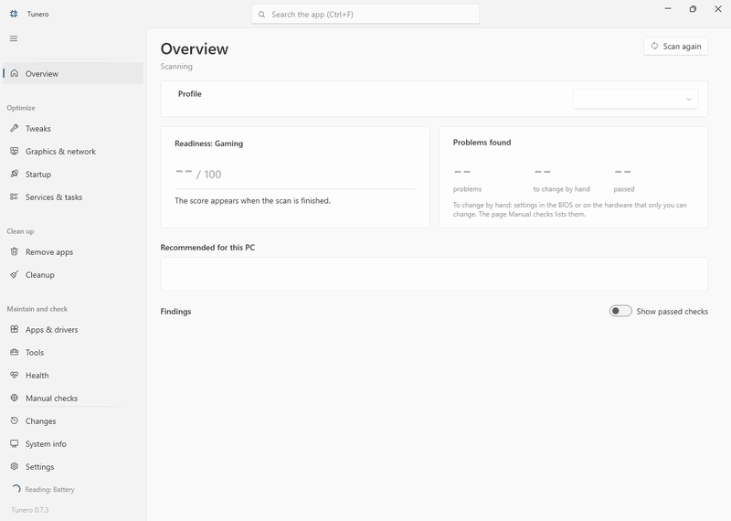
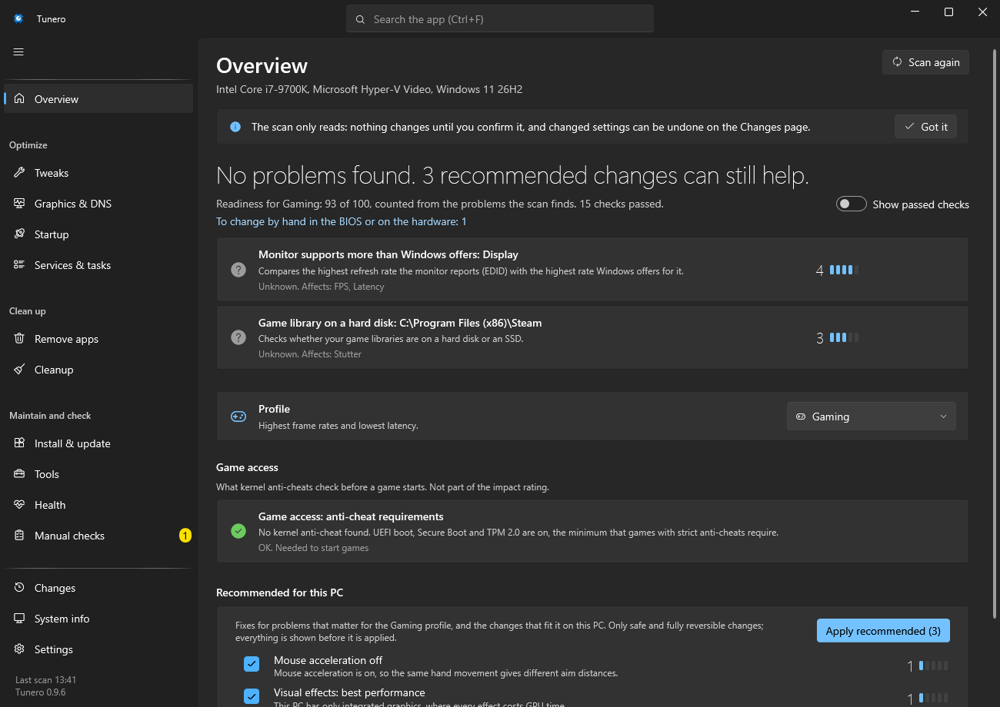
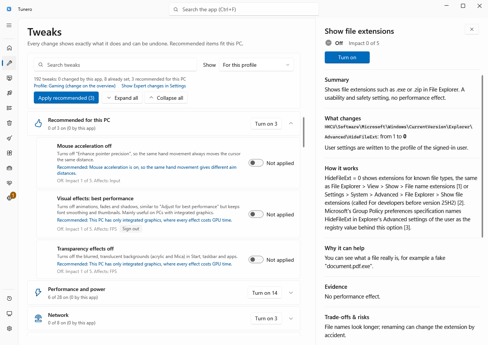
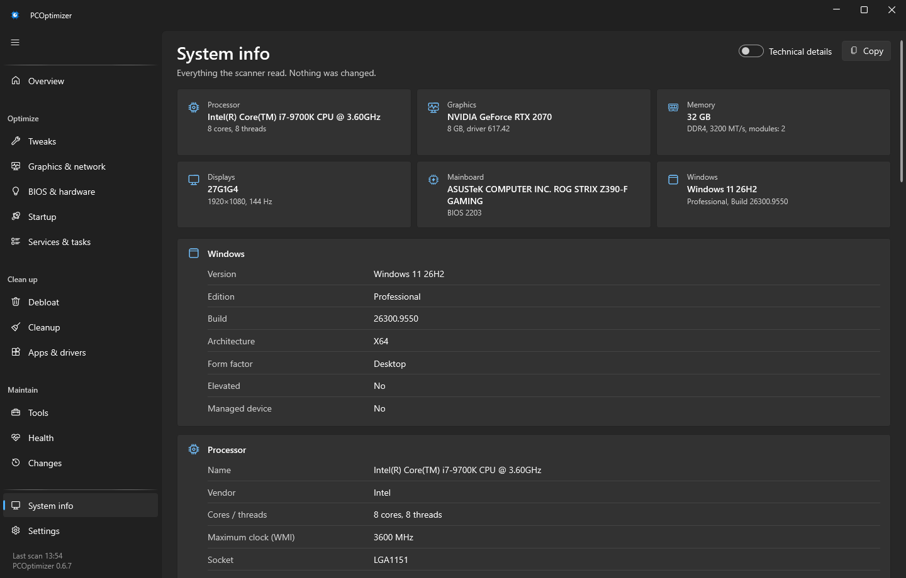
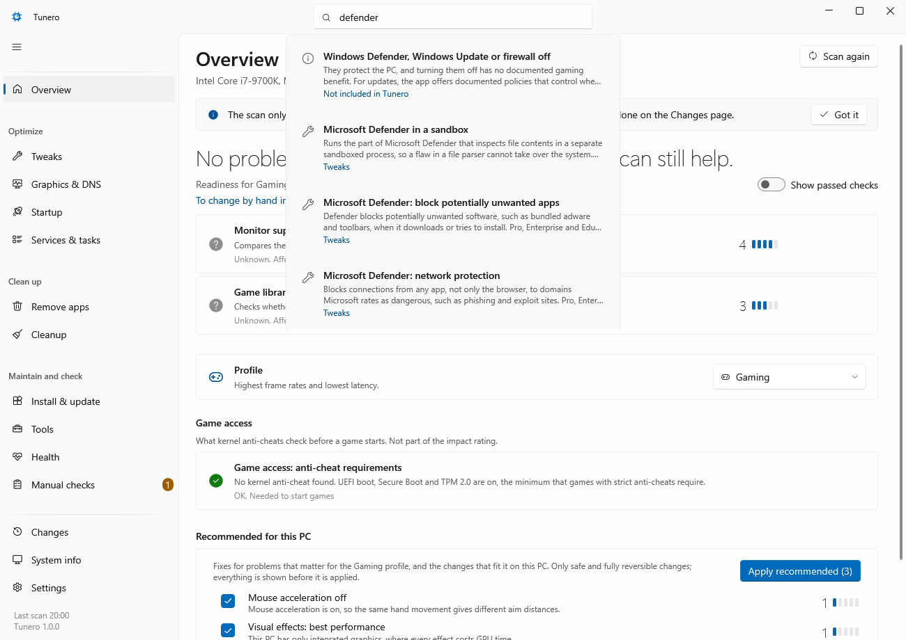

<p align="center"></p>

# Tunero

**Built to be the only PC optimizer you need on Windows 11.**

Tunero finds what really costs your games frame rate, fixes what it can and tells you how to fix the rest. It brings the useful settings of the popular tweak tools, debloat scripts and system utilities into one app (privacy, debloat, cleanup, startup, services, Windows Update) and leaves out the placebo. Every finding and every change comes with an explanation and sources, and every setting it changes is backed up first and can be undone. Gaming first, with profiles for laptops, battery, office, quiet and older PCs. One exe for Windows 11 25H2 or newer (x64), in English and German. Website: [tunero.dev](https://tunero.dev).

<p align="center"></p>

## Download

Get `Tunero.exe` from the [Releases](https://github.com/jozuern/Tunero/releases) page and compare its SHA-256 with the `.sha256` file next to it (`Get-FileHash Tunero.exe`). The in-app update also checks the release signature (`Tunero.exe.sig`) and installs nothing without a valid one. Releases after 1.0.0 also carry a build provenance attestation: `gh attestation verify Tunero.exe --repo jozuern/Tunero` shows that GitHub's release workflow built the exe from the tagged commit of this repository. A published release cannot be changed afterwards (GitHub's immutable releases). The exe asks for administrator rights because it changes system settings. It is not code signed yet, so Windows SmartScreen may warn on first start: "More info", then "Run anyway" ([Code signing](#code-signing)). The exe needs no installation; on the first start it offers an entry in the Start menu, so Windows Search finds it.

Or with a package manager:

| | Install | Start |
|---|---|---|
| winget (once the first version has passed review) | `winget install jozuern.Tunero` | `tunero` |
| Chocolatey (once the first version has passed moderation) | `choco install tunero` | `tunero` |
| Scoop | `scoop bucket add tunero https://github.com/jozuern/scoop-bucket`, then `scoop install tunero/tunero` | Start menu, Scoop Apps |

A copy installed this way is updated by its package manager: "Update now" in the app runs `winget upgrade`, `choco upgrade` or `scoop update` for you. winget and Chocolatey review every new version before they offer it, which can take a few days; the Scoop bucket picks up a release within a few hours.

## What it does

**For everyday use**

- **Scan and fix:** 50 read-only checks find real problems (a monitor at 60 Hz, memory without XMP, the wrong power plan, a game library on a hard disk, Windows waiting for a restart) and give BIOS and hardware advice (on the Manual checks page, which starts with a summary) and game access per anti-cheat. Each comes with what was found, why it matters, how to fix it and sources, in English and German. A check that cannot read something says "unknown" and gives no advice. A result you keep on purpose (a game library on a hard disk used as a backup) can be ignored; it then no longer counts.
- **Recommended for this PC:** after the scan, the Overview lists the fixes and changes that fit this PC and your profile as a checklist. Untick what you do not want; one confirmation lists every change before it is made. Expert, boot-critical, anti-cheat sensitive, Preview and not fully reversible items are never included.
- **Profiles:** Gaming, Laptop gaming, Battery, Office, Quiet and cool, Older PC. A profile changes nothing by itself; it decides what is recommended and which impact is shown.
- **Undo:** every change is backed up first (plus a restore point once per session), verified after applying and listed on the Changes page with Undo, also after a restart. After a Windows update the app lists changes Windows reset and offers to apply them again.
- **Remove apps and clean up:** a reviewed list of 130 removable apps (inbox apps, older Microsoft apps, third-party promotions and manufacturer apps, with a warning on vendor update tools), desktop programs with their own uninstaller (several in a row, quietly where the program offers it, a search for unused program folders, then a check for the folders and shortcuts they left behind), and 12 cleanup categories that never follow links.
- **Windows Update without surprises** (Pro and higher, documented policies): no update restarts in the evening, restarts when you choose for up to a week, monthly updates one week later.
- **Search:** Ctrl+F searches the whole app: tweaks, checks, tools, settings, services, startup entries and apps. Looking for a popular tweak the app leaves out shows why.

**For power users**

- **235 catalog tweaks** with gaming impact from 0 to 5, how solid the evidence is (situational or disputed), risk and sources, grouped by area with "Turn on N" per group and a Show filter (for this profile, recommended for this PC, changed by this app, all that apply, or all), plus tweaks built for this PC: per-game NVIDIA profiles, MSI mode per device and interrupt affinity for the graphics card (Expert), startup entries, services, Windows features.
- **Exact changes:** the confirmation lists every registry value, service, task or setting with its current and new value; blocked changes say why.
- **Privacy, browsers and Windows:** documented policies for Microsoft Edge, Google Chrome and Brave (data collection, AI features, promotions), Windows AI features (Recall, Paint, Notepad), app permissions, notifications, the taskbar and Start, and security options such as LSA protection and Defender network protection.
- **Graphics & DNS:** NVIDIA driver settings through the documented driver settings interface (NVAPI), "Prefer maximum performance" per game, a DNS server choice and an opt-in DNS benchmark. Network adapter power saving is in the tweaks, the VRR state in the scan.
- **Startup and services:** an Autoruns-style list of the places programs start from (Run keys and startup folders, scheduled tasks, services and drivers, Explorer extensions, Winlogon, image hijacks, AppInit, Active Setup, print monitors, LSA and network providers, codecs, WMI and more) with signature checks, VirusTotal lookups (your own key) snapshots to compare, an export of the list as a CSV file and Delete for Run, RunOnce, policy Run and cmd.exe AutoRun values, Startup folder files and tasks of other programs (backed up, undone on the Changes page), and service start types with explanations.
- **Apps that were not reviewed:** on request, Remove apps also lists the other removable apps, with a warning.
- **Install & update:** install common apps with winget or search winget for any other package, update them one at a time or all at once, and see how old the drivers are, grouped by where to get updates.
- **Storage:** a page of its own that reads a drive only when you select Analyze (with Stop), then shows it as a folder tree beside a treemap, the space by file type, its largest files and, on request, duplicate files. Open in Explorer, Copy path and Move to Recycle Bin work on files and folders. Windows, program, game and AppData folders, drive roots, user profiles and folders such as Documents themselves are never offered for deletion, and every item is checked again when it is moved; what you delete goes to the Recycle Bin.
- **Tools and health:** Windows features, program start priorities, network fixes, Windows Update repair, SFC and DISM, quick fixes (icon cache, Defender update, winget sources, Advanced startup for Safe Mode), a frame time benchmark with PresentMon, throttle check, drive health, opt-in sensors.
- **New accounts:** copy the per-user tweaks you turned on to the Default profile, so accounts created later start with them (undone on the Changes page).
- **Export, Import and command line:** move your changes to another PC or a fresh install, if you like with removed apps, service start types and startup entries, in the app or with `--apply` ([Command line](#command-line)).
- **System info:** everything the scan read, from processor and memory modules to displays, drives, firmware security and the power plan, with a button that copies it all for a forum post or a bug report.
- **Keyboard:** Ctrl+F search (Down into the results, Enter opens, Esc clears), F5 reads the page again or scans again, Esc closes the details pane.

The app uses settings that Microsoft or the hardware vendor documents. A few harmless, fully reversible tweaks use a value Microsoft does not document (the value behind a Windows Settings switch, or a widely used one such as the classic right-click menu): they carry an "Undocumented value" badge, their explanation page says so, and they stay previews until a test has shown that the value works. It never recommends turning off security features that anti-cheats require, and keeps changes that turn off security features or touch the boot configuration in Expert mode.

<p align="center"></p>

<p align="center"></p>

<p align="center"></p>

## What it does differently

- **It shows its work.** Every check and every change has a page with what it does, why, how solid the evidence is and the sources, in English and German.
- **Every setting it changes can be undone.** Each change is backed up first and can be undone on the Changes page, also after a restart or an update of the app; Uninstall offers to undo everything before it removes the app. Removed apps and deleted files are the exception, and the app says so before.
- **No placebo.** Popular tweaks without evidence are left out, and the search says why when you look for one. The full list with sources is in [docs/not-included.md](docs/not-included.md).
- **It looks at your PC first.** It recommends only what fits this PC and your profile, and keeps risky changes behind Expert mode.
- **Nothing runs in the background.** No service, no tray icon, no telemetry. Windows applies the settings itself; the app runs only when you start it.

## How it is tested

The tests apply and undo every catalog tweak made of registry values against a registry sandbox, restore a saved backup of every kind of change the way an earlier version wrote it, and run the other changes against fake system interfaces; the [VM test plan](docs/vm-test-plan.md) runs on Windows 11 26H2 Pro in a Hyper-V virtual machine before releases (Home and 25H2 are supported but have been tested less). A few parts need hardware a virtual machine does not have (NVIDIA driver settings, network adapter properties, laptop and battery checks, AMD-specific checks): tweaks that are not proven yet carry a **Not yet tested on a real PC** badge and are never part of "Apply recommended". Create a restore point or a backup before you change anything; the app creates one before its first change if System Protection is on.

## What it does not replace

Tunero is built to be the only PC optimizer you need, and it says plainly where it is not:

- **Driver removal and custom driver packages:** a clean graphics driver removal stays with Display Driver Uninstaller (DDU) and custom NVIDIA packages with NVCleanstall; the Drivers card links to both.
- **Live per-process rules:** Process Lasso adjusts running programs all the time, which needs a program in the background. Tunero runs only when you start it, so it offers start priorities that Windows applies by itself instead.
- **Security trade-offs:** tweaks that turn off Defender, UAC, updates or exploit protections for a few frames stay out ([docs/not-included.md](docs/not-included.md) lists them with sources). Tools such as AtlasOS that do this go further than Tunero on purpose.
- **Installing Windows:** media creation and setup changes (Flyoobe, Rufus) are out of scope; Tunero optimizes the Windows that is running.

<p align="center"></p>

## Command line

For a fresh install or several PCs, export your changes (on the Changes page or with `--export`) and apply the file without the window, or apply the recommended list of a profile:

```powershell
Start-Process Tunero.exe -ArgumentList '--apply', 'my-changes.tunero.json', '--log', 'result.txt' -Verb RunAs -Wait
Start-Process Tunero.exe -ArgumentList '--apply-recommended', '--profile', 'gaming', '--log', 'result.txt' -Verb RunAs -Wait
```

| Switch | Effect |
|---|---|
| `--apply <file>` | Applies an exported changes file with the rules of Import: Preview, Expert and anti-cheat sensitive changes are listed in the log, not applied. |
| `--apply-recommended` | Applies the Overview's recommended list (fixes of problems found, then what the profile recommends for this PC) with the same rules: what needs its own confirmation is listed in the log, not applied, and nothing is applied for a result ignored in the app. |
| `--profile <id>` | The profile for `--apply-recommended`: gaming, laptopGaming, battery, office, quiet or lowEnd. Without it, the profile saved in the app (or the one that fits this PC best). |
| `--export <file>` | Writes the changes file the Changes page exports, to a new file. |
| `--include <parts>` | Adds opt-in parts to `--export`, separated by commas: `apps` (removed apps), `services` (service start types), `startup` (startup entries turned off). `--apply` changes services and startup entries only where the PC has them and its rules allow it, and lists removed apps without removing them: Import in the app asks for them. |
| `--reapply` | Applies again the changes Windows reset (what "Apply again" offers on the Overview); the opt-in task in Settings runs this after sign-in. |
| `--undo-all` | Undoes every change of this app. |
| `--no-restore-point` | Continues when no restore point can be created (System Protection off); without it, nothing is changed then. |
| `--log <file>` | Writes the result to a new text file; an existing file is never overwritten. |

Exit codes: 0 done, 1 some changes failed, 2 not a valid changes file, 3 no administrator rights, 4 no restore point, 5 another Tunero window or run was changing the PC for 5 minutes, 6 unexpected error (details in the log), 7 Windows version not supported, 8 the start was refused for safety (a profiler variable, or a data or runtime folder that other accounts can change), 9 unknown profile or one this PC does not offer (a laptop profile on a desktop), 10 unknown part for `--include`.

## Privacy

No telemetry, no accounts. The app goes online only for features you start or turn on (update check, VirusTotal lookup, DNS benchmark, app installs). After an unexpected error it asks whether to open a GitHub bug report filled in with the error details, without your user or computer name; nothing is sent unless you submit it there. Details: [docs/PRIVACY.md](docs/PRIVACY.md).

## Uninstall

Settings > Uninstall removes Tunero from this PC. When changes of the app are still active, it offers to undo them first; if one cannot be undone, it removes nothing. Then the app closes, and a moment later its exe, its data folder `%ProgramData%\Tunero` (backups, logs, settings) and its Start menu entry are gone. A copy installed with winget, Chocolatey or Scoop is removed by that package manager (`winget uninstall jozuern.Tunero`, `choco uninstall tunero`, `scoop uninstall tunero`), so its list stays right; uninstalling with the package manager alone keeps the data folder and its backups.

What stays: restore points, apps you installed through Tunero and the PawnIO sensor driver. Remove them in Windows under Settings > Apps > Installed apps if you no longer need them. To remove Tunero by hand: undo your changes on the Changes page, then delete the exe, the folder `%ProgramData%\Tunero` and `Tunero PC Optimizer` in the Start menu folder (`%AppData%\Microsoft\Windows\Start Menu\Programs`).

## FAQ

**Was this called PCOptimizer?** Yes, up to version 0.7.3. Links to the old repository address and the in-app update keep working, and the data folder with your backups moves to the new name on the first start.

**Why is tweak X not included?** Many popular tweaks do nothing on Windows 11, use settings nobody documents, or cost more than they bring. Search for it in the app (Ctrl+F) to see the reason; [docs/not-included.md](docs/not-included.md) lists them all with sources, including the ones earlier versions offered.

**What does "Not yet tested on a real PC" mean?** This badge (a "Preview" in the catalog) marks tweaks that are risky or whose effect is not proven on real Windows yet: every Expert and boot-critical change, undocumented values without proof, and settings not yet tested on real hardware (such as the NVIDIA driver settings). "Apply recommended" never includes it. Apply it on its own, after a restore point, and check the result.

**Will it make my games faster?** When the scan finds a real problem, often clearly: a monitor at 60 Hz, memory without XMP or a processor held at its base clock cost a lot of frame rate, and the app fixes them or tells you how. Most catalog tweaks are about privacy, the browser and Windows settings and rate 0 for games; the ones that can matter are rated per PC, and each page says how solid the evidence is. The benchmark on the Health page lets you measure your own games.

**Can I undo everything?** Every change the app makes is backed up and can be undone on the Changes page, also after a restart or an update of the app. Removing an inbox app cannot be undone by the app; the Store link stays where the Store still offers it.

**Does it work on Windows 11 Home?** Yes. Some Group Policy based tweaks only work on Pro, Enterprise or Education; the app does not offer them on Home. Home has been tested less than Pro so far.

**Which Windows versions?** Windows 11 25H2 and newer on x64. Home and Pro 24H2 get no updates since 13 October 2026: on 24H2 the app still starts, with a note, so changes made there can be undone, but update Windows before you make new ones. Builds newer than the ones it was tested on run with a "not validated" note.

**Why does it need administrator rights?** Most settings it changes are machine-wide. Its data folder (`%ProgramData%\Tunero`) is locked to administrators, and links or files planted there by other accounts are removed before use.

## License

Copyright (c) 2026 Joshua Zürn. Tunero is free software: you can use, study, change and share it under the [GNU General Public License version 3](LICENSE) (GPL-3.0-only). Versions you share, changed or not, must stay under the same license and come with their source code. It comes without warranty. Releases up to 0.7.1 were published under the PolyForm Strict License 1.0.0; later releases are under the GPL.

The exe contains third-party components under their own licenses (MIT, BSD-2-Clause, BSD-3-Clause, MPL-2.0, LGPL-2.1-or-later, Apache-2.0); the full texts are in the app under Settings > About > Licenses and listed in [docs/THIRD-PARTY-NOTICES.md](docs/THIRD-PARTY-NOTICES.md).

## Code signing

Releases are not code signed yet. [SignPath Foundation](https://signpath.org/), which signs open source projects for free, turned down the first application in October 2026: it signs projects that are already widely known (stars, forks, articles, discussions), and Tunero is new. The project will apply again once it is better known. Until then, the SHA-256 file and the release signature (`Tunero.exe.sig`, checked by the in-app update) are how to check a download.

The policy that will apply once releases are signed:

- **Who is involved:** the project has one member, [Joshua Zürn](https://github.com/jozuern), who is committer, reviewer and approver. Changes from anyone else (pull requests) are reviewed by him before they are merged. Signing requests are approved by him, one release at a time.
- **What gets signed:** only `Tunero.exe` as built by the [release workflow](.github/workflows/release.yml) on GitHub's runners from a version tag on `main`. SignPath checks that the file comes from that build and that its product name and version match the release ([artifact configuration](.signpath/artifact-configuration.xml)). Nothing built elsewhere and no third-party program is signed.
- **Accounts:** GitHub and SignPath accounts of the team use multi-factor authentication.
- **Privacy:** This program will not transfer any information to other networked systems unless specifically requested by the user or the person installing or operating it. The features that go online when you start or turn them on are listed in [docs/PRIVACY.md](docs/PRIVACY.md).

Once releases are signed, Windows shows "SignPath Foundation" as their publisher. To check a download: right-click the exe, Properties > Digital Signatures, or `Get-AuthenticodeSignature Tunero.exe` in PowerShell; and compare its SHA-256 with the `.sha256` file of the release.

## Support

Tunero is free. If it helps you and you want to give something back, you can support its development on [Ko-fi](https://ko-fi.com/jozuern) (also linked in the app under Settings > About) or through [GitHub Sponsors](https://github.com/sponsors/jozuern). Support unlocks nothing: every feature is in the free exe. Bug reports and ideas help just as much.

## Credits

Tunero was built with the help of Claude, an AI assistant by Anthropic.

## Feedback and security

Bugs and ideas: open an issue. Security problems: see [SECURITY.md](SECURITY.md). Building from source and project layout: [CONTRIBUTING.md](CONTRIBUTING.md).
